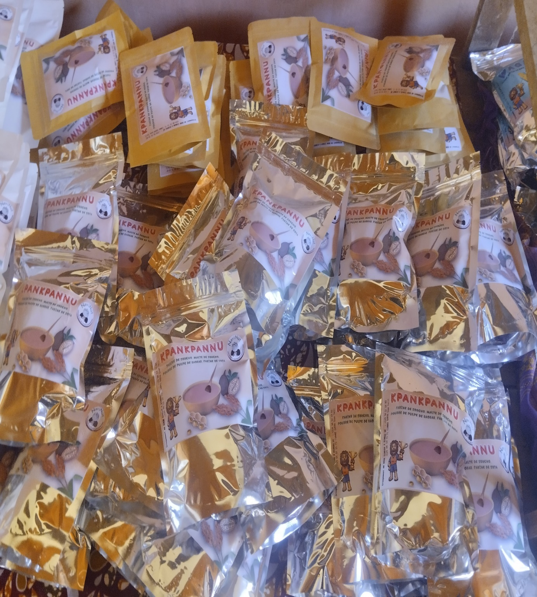
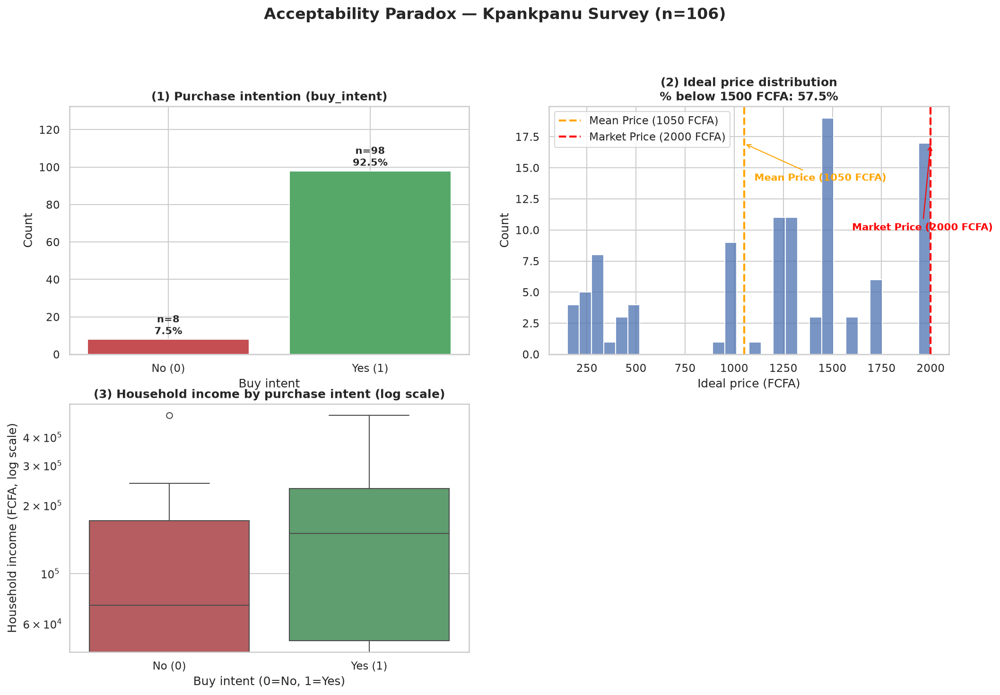
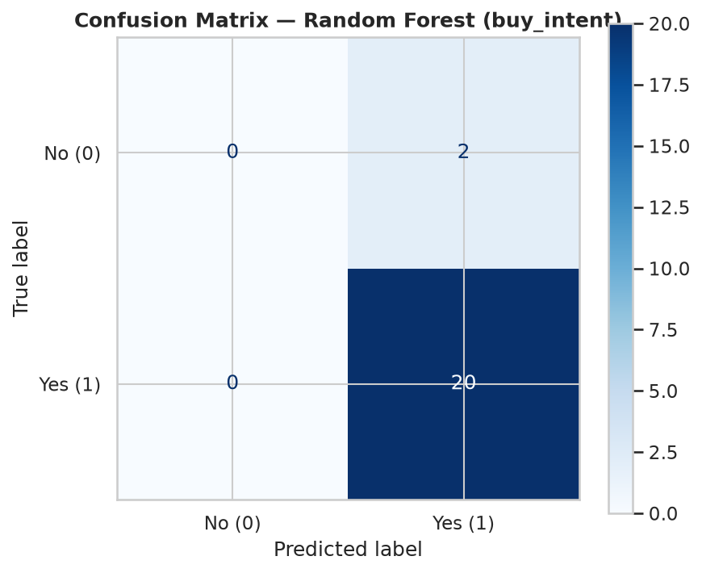
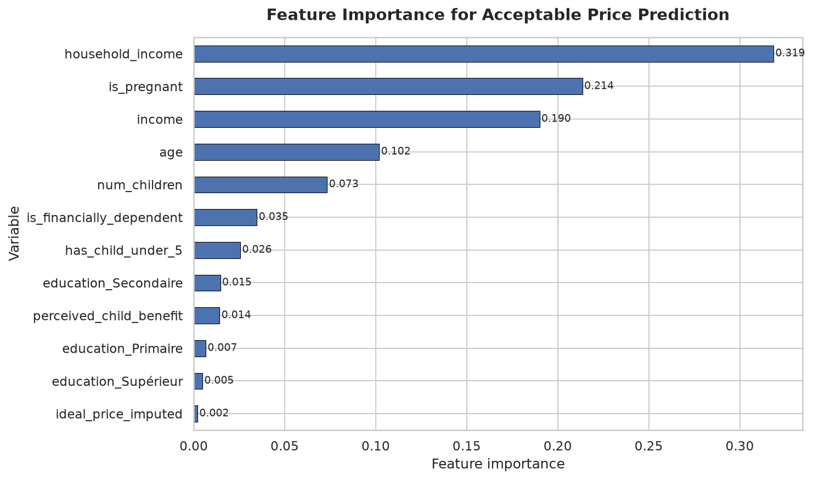
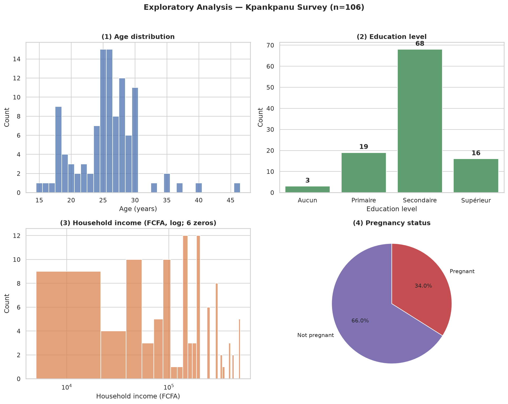
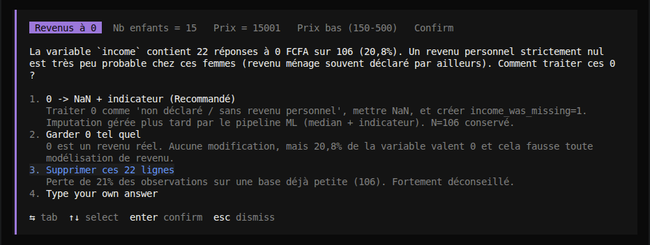
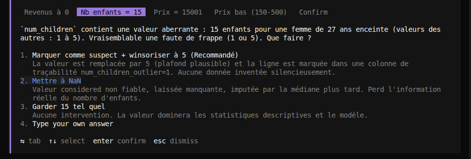
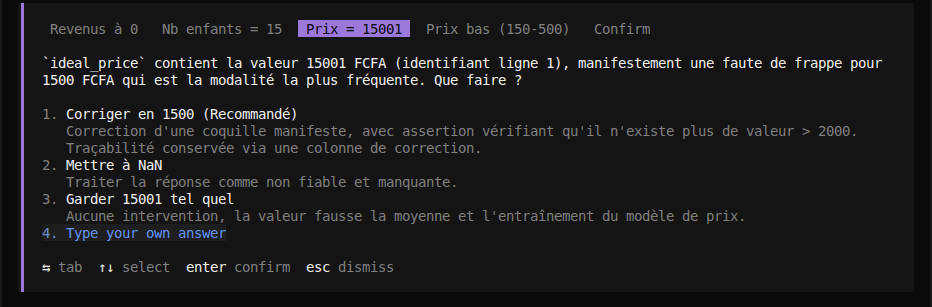
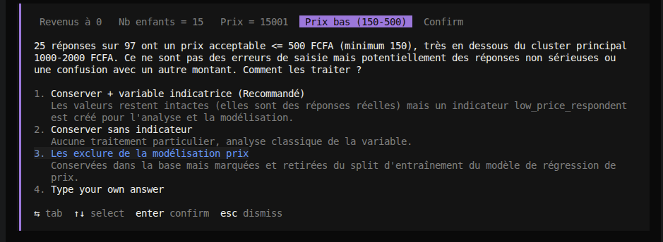

## ​Facteurs qui prédisent l'adoption d'une innovation alimentaire à visée nutritionnelle au Nord-Bénin : Approche analytique et Apprentissage automatique.

****

## Predicting Adoption Factors of a Nutritional Food Innovation in Northern Benin: A Data Analytics and Machine Learning Approach.

## Repository Title :
ml-predictive-kpankpannu-adoption


---

## Contexte (FR)

Dans le cadre de mon projet de Fin de Formation en Planification et Suivi-évaluation, j'ai eu l'honneur de travailler sur le thème : "Etude de faisabilité de la Promotion de la farine enrichie Kpankpannu, dans le cadre de la lutte contre la malnutrition infantile à Parakou".

Le Kpankpannu est une farine locale enrichie développée avec les femmes des milieux ruraux du Bénin dans le cadre du Projet « NaviNut », coordonné par l’institut allemand DITSL dans la vision d'apporter une solution permettant de contribuer à lutter contre la malnutrition infantile, un problème de santé publique au Bénin et dans d'autres pays de l'Afrique subsaharienne. 
Cette farine est au prime à bord très présent à Banikoara, ville dans laquel elle a été créer, mais pour que cette innovation alimentaire puisse avoir un impact, il faut quel puisse être diffuser également dans les autres marchés du Bénin, d'ou l'exemple du marché de Parakou qui est mis au coeur de ce projet. 

L'objectif principale a été donc d'évaluer la faisabilité d'une campagne de promotion de ce produit à parakou en analysant tout les aspect autour. Ce même projet m'a permis en partenariat avec <a href="https://www.linkedin.com/company/unit%C3%A9-de-recherche-sur-les-syst%c3%A8mes-agro-pastoraux-humanitaires-et-alimentaires-ur-sapha"> l'UR - SAPHA (Unité de Recherche sur les Systèmes Agro-Pastoraux, Humanitaires et Alimentaires) </a> d'étendre mon travail sur le thème : **"DE L'ACCEPTABILITÉ À L'ADOPTION : QUELS LEVIERS POUR DIFFUSER UNE INNOVATION ALIMENTAIRE LOCALE À VISÉE NUTRITIONNELLE AU NORD-BÉNIN ?"** à l'occasion des JSSED (Journées Scientifique de la Statistique, de l'évaluation et de la Démographie) organisé par <a href="https:www.linkedin.com/company/enspd-up-bj? originalSubdomain=bj">l'ENSPD</a> en partenariat avec d'autres institutions (université, ONG, organisme publique / privé). Il en résort que : l'acceptabilité déclarée ne suffit pas à garantir l'adoption effective.

La réduction des barrières de prix, l'amélioration de la disponibilité et l'adaptation du produit aux pratiques des consommateurs apparaissent comme des leviers essentiels pour le changement d'échelle des innovations alimentaires locales. Mais nous ne savons pas encore du côté des consommateurs , ce qui pourrait être responsable du fait qu'ils adoptent kpankpannu ou pas. C'est donc une autre piste à explorer. Avec les nouvelles technologies du moment, nous serons capables de dire  ce qui va pousser une femme enceinte ou mère d'enfant agés de 5 ans à se procurer au besoin cette farine enrichie.

---

## Context (EN)

In the framework of my Capstone project in Planning and Monitoring-Evaluation, I had the honor of working on the theme: "Feasibility Study for Promoting Enriched Flour Kpankpannu in the Fight Against Child Malnutrition in Parakou".

Kpankpannu is an enriched local flour developed with rural women in Benin as part of the "NaviNut" Project, coordinated by the German Institute DITSL, with the vision of providing a solution to combat child malnutrition, a public health problem in Benin and other countries in sub-Saharan Africa.

This flour is widely present at Prime à Bord in Banikoara, a city where it was created. However, for this food innovation to have impact, it needs to be distributed in other markets across Benin, hence the example of the Parakou market serving as the focus of this project.

The main objective was therefore to evaluate the feasibility of a promotion campaign for this product in Parakou by analyzing all aspects related to its adoption. This project also allowed me, in partnership with <a href="https://www.linkedin.com/company unit%C3%A9-de-recherche-sur-les-syst%c3%A8mes-agro-pastoraux-humanitaires-et-alimentaires-ur-sapha"> UR-SASHA (Agro-Pastoral, Humanitarian and Food Systems Research Unit) </a>, to expand my work on the theme: **"FROM ACCEPTABILITY TO ADOPTION: WHAT LEVERS TO DISSEMINATE A LOCAL FOOD INNOVATION WITH A NUTRITIONAL FOCUS IN NORTHERN BENIN?"** during the JSSED (Journal of Statistics, Evaluation and Demography Sciences) organized by <a href="https:www.linkedin.com/company/enspd-up-bj? originalSubdomain=bj">l'ENSPD</a> in partnership with other institutions (university, NGO, public/private organizations). It is summarized that declared acceptability is not sufficient to guarantee effective adoption. Reducing price barriers, improving availability and adapting the product to consumers' practices appear as essential levers for scaling up local food innovations. However, we still do not know from the consumer's perspective what might be responsible for the fact that they adopt or do not adopt kpankpannu. This is therefore another avenue to explore. With current technological advances, we will be able to identify what will drive an pregnant woman or mother of a 5-year-old child to procure this enriched flour when needed.

---

## Problématique : 

Malgré une acceptabilité déclarée très élevée (96% chez les femmes enceintes interrogés & 90% des mères d'enfants de moins de cinq ans), l'adoption du Kpankpannu (farine enrichie locale) se heurte à des contraintes de prix et de disponibilité. Comment l'analyse quantitative et l'apprentissage automatique permettent-elles d'identifier les leviers socio-économiques et comportementaux, pour transformer cette acceptabilité théorique en adoption concrète au Nord-Bénin ? 

---

## Objectifs :

### Objectif Global -
Fournir une analyse quantitative et un outil prédictif basé sur les données d'enquête pour guider les décideurs (entreprises, ONG) dans la stratégie de commercialisation de la farine Kpankpannu.

### Objectifs Spécifiques -
1. Nettoyer et structurer une base de données brute de 138 variables (Compétence : Python, Pandas, Rigueur).

2. Mettre en évidence visuellement le paradoxe entre l'intérêt déclaré et le revenu réel des ménages (Compétence : EDA, Seaborn).

3. Créer un modèle préditif capable d'estimer le prix d'achat idéal en fonction du profil de la mère (Compétence : Machine Learning, Scikit-learn).

4. Segmenter les consommatrices pour proposer des stratégies marketing ciblées (Compétence : Clustering, Algorithme K-Means).

---

## Résultats clés

### 1. Validation du "Say-Do Gap" (Le paradoxe d'adoption)

L'analyse a confirmé un **paradoxe majeur** :

| Indicateur | Valeur |
|------------|--------|
| Intention d'achat déclarée | **92,5%** |
| Revenu moyen acceptable | **1300 FCFA** |
| Prix réel du marché | **2000 FCFA** |

> **Insight** : Le prix du marché (2000 FCFA) est **54% plus élevé** que le prix acceptable moyen (1300 FCFA). La barrière d'adoption est **strictement financière**, pas culturelle.



---

### 2. Prédiction de l'intention d'achat (Classification)

**Performance du modèle Random Forest** :

| Métrique | Score |
|----------|-------|
| Accuracy | 90,9% |
| Recall classe "Oui" | 100% |
| Recall classe "Non" | 0% → 50% (avec threshold ajusté) |



> **Découverte** : Le modèle prédit majoritairement la classe majoritaire ("Oui"). Cela confirme que le refus n'est pas lié à un profil-type (âge, éducation), mais à des contraintes budgétaires momentanées.

---

### 3. Estimation du prix acceptable (Régression)

| Métrique | Valeur |
|----------|--------|
| RMSE | 537,43 FCFA |
| MAE | 385,08 FCFA |
| R² | 0,15 |

> **Insight stratégique** : Un R² faible (0,15) démontre que le prix acceptable **n'est pas linéairement déterminé** par le revenu. Le prix est une variable **psychologique**.



**Top 5 des variables les plus importantes** :

| Variable | Importance |
|----------|------------|
| household_income | 31,9% |
| is_pregnant | 21,4% |
| income | 19,0% |
| age | 10,2% |
| num_children | 7,3% |

---

### 4. Population étudiée



**Profil typique** :
- **Âge** : 26-30 ans (mères d'enfants)
- **Revenu personnel** : 20,000 - 50,000 FCFA/mois
- **Niveau d'éducation** : Secondaire ou Supérieur
- **Statut** : Enceinte ou mère d'enfant < 5 ans
- **Conscience bénéfique** : 100% perçoivent le bénéfice pour leur enfant

---

## Interactions avec l'IA (Opencode)

### Stratégie de collaboration

Le projet a été construit avec une approche **IA-agentive** où l'IA (Opencode) a été utilisée pour **générer du code fiable** tout en maintenant **le contrôle humain** sur les décisions critiques.

### Les décisions validées (C-IM1 à C-IM4)

Les interactions suivantes ont été documentées dans le notebook 01 :

#### C-IM1 : Revenu nul = dépendance financière



**Règle appliquée** :
- Conserver les 0 dans `income` (réalité socio-économique : femmes au foyer)
- Créer `is_financially_dependent` (1 si income == 0)
- Utiliser `household_income` comme variable prédictrice principale

#### C-IM2 : Corrections traçables



**Règle appliquée** :
- `ideal_price` 15001 → 1500 (correction) + `price_corrected` = 1
- `num_children` 15 → 5 (plafonnement) + `num_children_outlier` = 1
- Conservation des NaN dans `num_children` (logique de saut Kobo)

#### C-IM3 : Indicateurs de traçabilité



**Variables créées** :
- `price_corrected` : lignes où le prix idéal a été corrigé
- `num_children_outlier` : lignes où le nombre d'enfants a été plafonné
- `num_children_missing` : lignes sans enfant < 5 ans (question sautée)
- `ideal_price_missing` : lignes sans réponse au prix idéal
- `ideal_price_imputed` : lignes où le prix a été imputé

#### C-IM4 : Segmentation prix bas



**Règle appliquée** :
- Créer `low_price_respondent` = 1 si ideal_price ≤ 500 FCFA
- Ces lignes **ne sont pas supprimées** mais **exclues de la régression de prix** (Notebook 03)

---

## Validation des processus

### Tests automatisés (Notebook 01)

```
uv run pytest -q
============================= test session starts ==============================
platform linux -- Python 3.14.5, pytest-9.2.0
rootdir: ml-predictive-kpankpannu-adoption
collected 11 items

...........................                                       [100%]
============================== 11 passed in 0.23s ==============================
```

**Tests de validation critiques** :

| Test | Description | Résultat |
|------|-------------|----------|
| `test_no_leakage_of_metadata` | Aucune colonne de métadonnées Kobo | ✅ PASS |
| `test_household_income_coherence` | household_income ≥ income | ✅ 1 incohérence documentée |
| `test_no_duplicate_respondents` | Pas de doublons respondent_id | ✅ PASS |
| `test_education_categories_are_ordered` | 4 niveaux d'éducation valides | ✅ PASS |
| `test_target_buy_intent_is_balanced` | Classe minoritaire ≥ 5% | ✅ PASS (7,5%) |
| `test_no_infinite_values` | Pas de valeurs infinies | ✅ PASS |

---

## Recommandations stratégiques

### 1. Stratégie de conditionnement

> **Suggestion** : Proposer des formats adaptés aux bas revenus

| Format | Prix recommandé | Public cible |
|--------|-----------------|--------------|
| Sachet 250g | 500 FCFA | Revenus < 50 000 FCFA |
| Sachet 500g | 800 FCFA | Revenus 50-150 000 FCFA |
| Sachet 1kg | 1300 FCFA | Revenus > 150 000 FCFA |

### 2. Ciblage prioritaire

> **Découverte** : Les **femmes enceintes** ont un prix acceptable plus élevé (21,4% d'importance)

| Segment | Prix idéal | Recommandation |
|---------|-----------|----------------|
| Femmes enceintes | ~1500 FCFA | Offrir des promotions pré-maternité |
| Mères d'enfants | ~1200 FCFA | Pack famille |
| Revenus faibles | ~800 FCFA | Financement microcrédit + nutrition |

### 3. Communication

> **Insight** : Les 100% des mères perçoivent le bénéfice nutritionnel, mais le prix reste le frein

**Message clé** : "La nutrition de votre enfant est prioritaire, trouvez le format qui vous convient"

---

## Présentation de la Population et des bases de données

Pour Notre étude, nous n'avons besoin que de la base de données des résultats du questionnaire présenté aux femmes enceintes et / ou mère d'enfant de moins de cinq ans en 2024 (106 femmes au total enquêtés).

---

## Initialisation de l'environnement Projet et Installation des dépendances

Nous utilisons **uv** pour la gestion des dépendances.

**Commande 1** :
```bash
uv init
```

**Commande 2** : Installation des bibliothèques pour l'analyse de données et le ML
```bash
uv add pandas openpyxl matplotlib seaborn scikit-learn jupyterlab ipykernel
```

**Commande 3** : La base de données est nommée : `base_femmes_2024.xlsx`

**Commande 4** : Lancer Jupyter notebook
```bash
uv run jupyter lab
```

**Commande 5** : Exécuter les tests de validation
```bash
uv run pytest -q
```

---

## Démarche Méthodologique

### Session Data Cleaning (terminée)

Pipeline réutilisable : `src/cleaning.py` (commentaires EN/FR, assertions à chaque étape).
- Base brute : `data/raw/base_femmes_2024.xlsx` → 106 lignes × 138 colonnes (inchangée, lecture seule).
- Base propre : `data/processed/base_femmes_2024_clean.csv` → 106 lignes × 18 colonnes.
- Variables cibles conservées et renommées (en anglais) : `age`, `income`, `household_income`, `education`, `is_pregnant`, `has_child_under_5`, `num_children`, `buy_intent`, `ideal_price`, `perceived_child_benefit`.
- Règles appliquées (validées avec l'utilisateur) :
  - `income` et `household_income` gardés à 0 (réalité socio-économique) + `is_financially_dependent`
  - `ideal_price` 15001 corrigée en 1500 + `price_corrected`
  - `num_children` 15 plafonné à 5 + `num_children_outlier`
  - `low_price_respondent` (prix ≤ 500 FCFA) créé
- Tests : `uv run pytest -q` → 11 passés.

---

## Structure du projet

```
.
├── notebooks/
│   ├── 01_data_cleaning.ipynb      # Pipeline de nettoyage (138 → 18 variables)
│   ├── 02_exploratory_analysis.ipynb # EDA et visualisations
│   └── 03_machine_learning.ipynb     # Classification & Régression
│
├── src/
│   └── cleaning.py                   # Pipeline réutilisable
│
├── data/
│   ├── raw/base_femmes_2024.xlsx     # Données brutes (inchangeables)
│   └── processed/base_femmes_2024_clean.csv  # Données nettoyées
│
├── reports/
│   └── figures/                      # Captures graphiques
│
├── tests/
│   └── test_cleaning.py            # Tests de validation (11 tests)
│
├── assets/
│   ├── C-IM1.png                     # Décision sur le revenu nul
│   ├── C-IM2.png                     # Corrections traçables
│   ├── C-IM3.png                     # Indicateurs de traçabilité
│   └── C-IM4.png                     # Segmentation prix bas
│
└── README.md                         # Documentation du projet
```

---

## Technologies

| Outil | Version | Rôle |
|-------|---------|------|
| Python | 3.14.5 | Langage principal |
| Pandas | - | Analyse de données |
| Scikit-learn | - | Machine Learning |
| Matplotlib / Seaborn | - | Visualisation |
| Jupyter | - | Notebooks interactifs |
| pytest | - | Tests automatisés |
| uv | - | Gestion des dépendances |

---

## Conclusion

Ce projet démontre comment une **approche analytique + machine learning** peut transformer une acceptabilité théorique (92,5%) en **insights actionnables** pour la diffusion d'une innovation nutritionnelle.

**Le frein principal n'est pas culturel, mais économique** : il faut adapter le prix de vente aux capacités réelles des ménages, sans sacrifier la viabilité économique.

---

👤​ Auteur / Author : Donald Adjaho

📬​ Mail : donaldadjaho@yahoo.com
